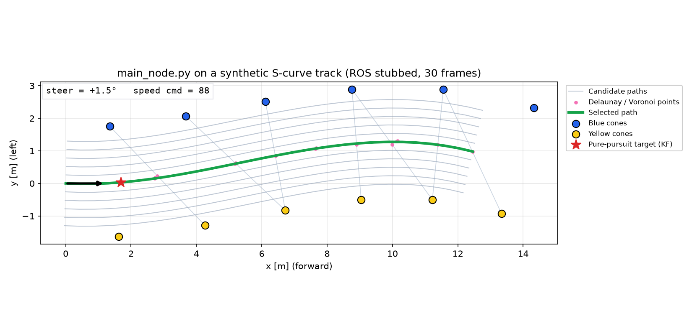

# FSD Path Planner

A ROS 1 node that plans a path through a cone-delimited track and outputs steering and speed commands.

It extracts the track centerline with Delaunay triangulation and Voronoi vertices, generates multiple smoothed candidate paths, selects one with a cost function, falls back to RRT\* when the centerline cannot be found, and tracks the result with a Kalman-filtered Pure Pursuit controller.



*`main_node.py` running on a synthetic S-curve track with ROS stubbed out. Reproduce with [`docs/make_demo.py`](docs/make_demo.py).*

## Method

1. **Filtering** – Cones outside the planning region of interest, and noise points right in front of the vehicle, are discarded.
2. **Centerline extraction** – Midpoints of Delaunay edges are kept only if the edge length matches a plausible gate width, the edge crosses the direction of travel, and the adjacent triangles have a bounded circumradius. Voronoi vertices with enough clearance from the cones are added.
3. **Ordering** – Points are ordered greedily from the vehicle, with limits on step distance and heading change.
4. **Candidate paths** – The ordered points are smoothed with a B-spline, and laterally offset copies are created (11 by default).
5. **Selection** – Each candidate is scored on obstacle clearance, curvature, smoothness, consistency with the previous path, and steering continuity. The previous choice is favored, and the result is blended with the previous path.
6. **Fallback** – If no centerline is found, a midline-guided RRT\* (`ma_rrt.py`) searches for a path.
7. **Control** – A speed limit is derived from path curvature. The lookahead target is smoothed by a Kalman filter, and steering is computed by Pure Pursuit with a curvature feed-forward term, followed by rate limiting and low-pass filtering.
8. **Failure handling** – When planning fails, the previous steering is held at reduced speed. After 15 consecutive failures, the node commands a stop.

## Files

```
main_node.py         Planner and controller node (fsd_main_planner)
ma_rrt.py            Midline-guided RRT* used as a fallback
plotter_node.py      Real-time telemetry plot (speed, steering, confidence, path)
test_planner.py      Standalone test of the fsd_path_planning library
fsd_path_planning/   Cone sorting, matching and path calculation library (see Credits)
docs/                Demo image and the script that generates it
```

## ROS interface

Subscribed:

| Topic | Type | Description |
|---|---|---|
| `/center_points` | `visualization_msgs/Marker` | Cone positions in the vehicle frame |

Published:

| Topic | Type | Description |
|---|---|---|
| `/cone/steer` | `std_msgs/Float32` | Steering angle in degrees, clipped to ±30 |
| `/cone/speed` | `std_msgs/Int32` | Speed command |
| `/cone/confidence` | `std_msgs/Float32` | Path confidence: 1.3 normal, 0.8 RRT, 0.5 short path, 0.2 / 0.0 on failure |
| `/fsd_planner/v_limit` | `std_msgs/Float32` | Curvature-based speed limit |
| `/fsd_planner/max_k` | `std_msgs/Float32` | Maximum curvature ahead |
| `/fsd_planner/best_path` | `visualization_msgs/Marker` | Selected path |
| `/fsd_planner/candidate_paths` | `visualization_msgs/MarkerArray` | All candidate paths |
| `/fsd_planner/delaunay_viz` | `visualization_msgs/Marker` | Delaunay edges and midpoints |
| `/fsd_planner/valid_cones` | `visualization_msgs/Marker` | Cones inside the region of interest |
| `/fsd_planner/target_point` | `visualization_msgs/Marker` | Filtered Pure Pursuit target |

## Usage

The files are meant to be placed in the scripts folder of a catkin package. Replace `<your_package>` with the package name.

```bash
pip install numpy scipy matplotlib
rosrun <your_package> main_node.py
rosrun <your_package> plotter_node.py   # optional
```

To run the planner without ROS on a synthetic track:

```bash
python docs/make_demo.py . docs/demo.png
```

## Parameters

All parameters are private (`~name`) and can be set on the command line, e.g. `rosrun <your_package> main_node.py _target_speed:=90`.

| Parameter | Default | Description |
|---|---|---|
| `target_speed`, `min_speed`, `max_speed` | 100, 80, 120 | Speed command range |
| `plan_distance` | 12.0 | Planning distance (m) |
| `wheelbase` | 0.6 | Vehicle wheelbase (m) |
| `min_gate_width`, `max_gate_width` | 2.8, 5.5 | Accepted distance between left and right cones (m) |
| `num_paths`, `max_offset` | 11, 1.3 | Number of candidate paths and maximum lateral offset (m) |
| `w_collision`, `w_curvature`, `w_smoothness`, `w_consistency` | 150, 5, 30, 30 | Cost weights |
| `min_ld`, `max_ld` | 1.0, 4.0 | Pure Pursuit lookahead range (m) |
| `friction_mu` | 0.75 | Friction coefficient for the curvature speed limit |
| `filter_alpha_steer`, `filter_alpha_ld` | 0.07, 0.2 | Low-pass filter coefficients |

See `load_parameters()` in [`main_node.py`](main_node.py) for the full list.

## Credits

[`fsd_path_planning/`](fsd_path_planning) is a modified copy of [papalotis/ft-fsd-path-planning](https://github.com/papalotis/ft-fsd-path-planning) by FaSTTUBe, released under the MIT License. The original license is included in [`fsd_path_planning/LICENSE`](fsd_path_planning/LICENSE).
