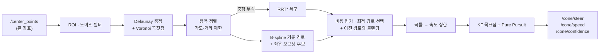

<div align="center">

# 🏎️ FSD Path Planner

**라바콘 트랙을 위한 하이브리드 경로 계획 + Pure Pursuit 제어 ROS 노드**

Delaunay · Voronoi 중앙선 추출 → B-spline 다중 후보 경로 → 비용 기반 선택 → (실패 시) RRT\* 복구 → 칼만 필터 + Pure Pursuit 조향


-22314E?logo=ros&logoColor=white)


<sub>가상 S자 콘 트랙에서 <code>main_node.py</code>를 실행한 결과 (ROS를 흉내 낸 오프라인 실행, <a href="docs/make_demo.py">docs/make_demo.py</a>로 재현 가능)</sub>

</div>

---

## ✨ 주요 기능

| | 기능 | 설명 |
|---|---|---|
| 🔺 | **Delaunay + Voronoi 중앙선** | 콘 삼각분할의 게이트 폭·외접원·진행방향 조건으로 유효한 중점만 고르고, Voronoi 꼭짓점으로 안전 공간을 보강 |
| 🌈 | **다중 후보 경로** | 기준 경로를 B-spline으로 부드럽게 만든 뒤 좌우로 오프셋한 후보 11개를 생성 |
| ⚖️ | **비용 기반 선택** | 충돌·곡률·부드러움·이전 경로 일관성·조향 연속성을 합산해 최적 경로 선택 (이전 선택에 가산점) |
| 🌲 | **RRT\* 복구** | 중앙선을 못 찾으면 중점을 가이드로 쓰는 RRT\*(`ma_rrt.py`)로 경로를 새로 탐색 |
| 🎯 | **칼만 필터 + Pure Pursuit** | 목표점을 KF로 안정화하고, 속도에 비례한 동적 lookahead와 곡률 피드포워드로 조향 계산 |
| 🛡️ | **안전 장치** | 조향·속도 변화율 제한, 저역 통과 필터, 콘 소실 시 이전 조향 유지 → 15프레임 이상 지속 시 비상 정지 |
| 📊 | **실시간 텔레메트리** | `plotter_node.py`가 속도·조향·신뢰도·경로를 matplotlib 대시보드로 표시 |

## 🧭 처리 흐름



## 📁 구성

```
.
├── main_node.py          # 메인 플래너 + 제어 노드 (fsd_main_planner)
├── ma_rrt.py             # 중앙선 가이드 RRT* (복구용)
├── plotter_node.py       # 실시간 텔레메트리 대시보드
├── test_planner.py       # fsd_path_planning 라이브러리 단독 테스트
├── fsd_path_planning/    # 콘 정렬·매칭·경로 계산 라이브러리 (MIT, 아래 크레딧 참고)
└── docs/
    ├── demo.png          # README 데모 이미지
    └── make_demo.py      # ROS 없이 데모 이미지를 다시 만드는 스크립트
```

## 🔌 ROS 인터페이스

**구독**

| 토픽 | 타입 | 설명 |
|---|---|---|
| `/center_points` | `visualization_msgs/Marker` | 차량 기준 좌표계의 콘 위치 (`points`) |

**발행**

| 토픽 | 타입 | 설명 |
|---|---|---|
| `/cone/steer` | `std_msgs/Float32` | 조향각 [deg], ±30° 제한 |
| `/cone/speed` | `std_msgs/Int32` | 속도 명령 |
| `/cone/confidence` | `std_msgs/Float32` | 경로 신뢰도 (정상 1.3 · RRT 0.8 · 짧은 경로 0.5 · 실패 0.2/0.0) |
| `/fsd_planner/v_limit` | `std_msgs/Float32` | 곡률 기반 속도 상한 |
| `/fsd_planner/max_k` | `std_msgs/Float32` | 전방 최대 곡률 |
| `/fsd_planner/best_path` | `visualization_msgs/Marker` | 선택된 경로 (RViz) |
| `/fsd_planner/candidate_paths` | `visualization_msgs/MarkerArray` | 후보 경로들 (RViz) |
| `/fsd_planner/delaunay_viz` | `visualization_msgs/Marker` | 삼각분할 간선·중점 (RViz) |
| `/fsd_planner/valid_cones` | `visualization_msgs/Marker` | ROI 내 유효 콘 (RViz) |
| `/fsd_planner/target_point` | `visualization_msgs/Marker` | KF 보정된 추종 목표점 (RViz) |

## 🚀 실행

ROS 1 catkin 패키지의 `src`(스크립트) 폴더로 쓰는 구성입니다. 패키지 이름은 환경에 맞게 바꿔 주세요.

```bash
pip install numpy scipy matplotlib
chmod +x main_node.py plotter_node.py

rosrun <your_package> main_node.py      # 플래너 + 제어
rosrun <your_package> plotter_node.py   # (선택) 텔레메트리 대시보드
```

ROS 없이 알고리즘만 확인하려면:

```bash
python docs/make_demo.py . docs/demo.png
```

## ⚙️ 주요 파라미터

`~private` 파라미터로 덮어쓸 수 있습니다. (예: `rosrun <pkg> main_node.py _target_speed:=90`)

| 파라미터 | 기본값 | 설명 |
|---|---|---|
| `target_speed` / `min_speed` / `max_speed` | 100 / 80 / 120 | 목표·최소·최대 속도 |
| `plan_distance` | 12.0 | 계획 거리 [m] |
| `wheelbase` | 0.6 | 축거 [m] |
| `min_gate_width` / `max_gate_width` | 2.8 / 5.5 | 유효한 좌우 콘 간격 [m] |
| `num_paths` / `max_offset` | 11 / 1.3 | 후보 경로 수 / 최대 좌우 오프셋 [m] |
| `w_collision` / `w_curvature` / `w_smoothness` / `w_consistency` | 150 / 5 / 30 / 30 | 비용 가중치 |
| `min_ld` / `max_ld` | 1.0 / 4.0 | Pure Pursuit lookahead 범위 [m] |
| `friction_mu` | 0.75 | 곡률 기반 속도 상한에 쓰는 마찰계수 |
| `filter_alpha_steer` / `filter_alpha_ld` | 0.07 / 0.2 | 조향·lookahead 저역 통과 계수 |

전체 목록은 [`main_node.py`](main_node.py)의 `load_parameters()`를 참고하세요.

## 🙏 크레딧

- [`fsd_path_planning/`](fsd_path_planning)은 [papalotis/ft-fsd-path-planning](https://github.com/papalotis/ft-fsd-path-planning) (FaSTTUBe, MIT License)을 기반으로 수정한 코드입니다. 원본 라이선스는 [`fsd_path_planning/LICENSE`](fsd_path_planning/LICENSE)에 있습니다.
